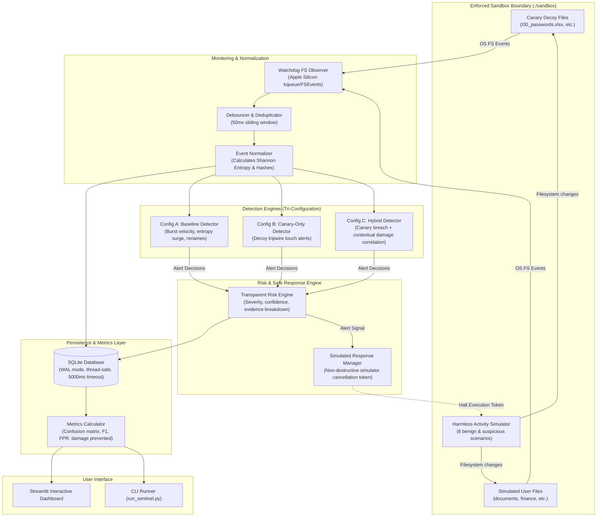

# CanarySentinel Architecture Documentation

## 1. System Overview

**CanarySentinel** is a lightweight, local, canary-based endpoint ransomware detection and behavioral analysis prototype engineered for macOS (Apple Silicon M1 architecture). It strictly operates on test files within a dedicated sandbox directory, deploying deceptive decoy files, monitoring filesystem activity using normalized events, evaluating three distinct detector configurations, and safely simulating automated containment responses.

---

## 2. Architecture Diagram

---

## 3. Core Architectural Modules

### 3.1 Sandbox Manager (`canary_sentinel/core/sandbox.py`)
- **Isolation Enforcement**: Canonicalizes and verifies that every target path resolves strictly inside `./sandbox`.
- **Directory Traversal Prevention**: Evaluates canonical paths using `pathlib.Path.resolve()` and `is_relative_to()`. Rejects `..`, null-byte injections (`\0`), and absolute path escapes with `SandboxSecurityError`.
- **Symlink Jail**: Validates real targets of symlinks to prevent symlink traversal outside the sandbox.
- **Root Protection**: Refuses to initialize or execute on system roots (`/`, `/etc`, `/System`, `/Library`, `/Users`, `Path.home()`).
- **Safe Reset**: Provides explicit methods to clean sandbox files without destroying root permissions.

### 3.2 Canary Decoy Manager (`canary_sentinel/canary/manager.py`)
- **Deceptive Placement**: Deploys decoys with alphabetical advantage prefixes (`!00_`, `aaa_`, `0_`) into root and subdirectories (`documents`, `finance`, `projects`, `backups`).
- **High-Value Decoy Formats**: `.xlsx` (corporate passwords), `.pdf` (financials), `.csv` (salaries), `.sql` (database backups), `.docx` (contracts).
- **Integrity Verification**: Computes SHA-256 hashes of all deployed decoys and tracks disk status (`ACTIVE`, `MODIFIED`, `DELETED`).
- **Fast Lookup**: Maintains in-memory index of canary paths for instant \(O(1)\) tagging during event normalization.

### 3.3 Event Normalizer & Debouncer (`canary_sentinel/monitoring/normalizer.py`)
- **Uniform Event Representation**: Generates immutable `NormalizedEvent` records containing:
  - `event_id`, `timestamp`, `iso_timestamp`, `event_type` (`CREATE`, `MODIFY`, `DELETE`, `MOVE`)
  - `path`, `src_path`, `extension`, `is_canary`, `size_bytes`, `entropy`
  - `process_id`, `process_name`, `scenario_id`
- **Shannon Entropy Calculation**: Computes Shannon entropy ($H(X) = -\sum p(x) \log_2 p(x)$) on modified file chunks (0.0 to 8.0 bits/byte). Plaintext is typically 3.0–5.5; simulated encrypted chunks exceed 7.2.
- **macOS Event Debouncing**: Debounces identical (path, event_type) events within a 50ms window to absorb OS buffer flushes without losing rapid bursts.

### 3.4 Filesystem Monitor (`canary_sentinel/monitoring/monitor.py`)
- Uses Python `watchdog.observers.Observer` anchored strictly to `sandbox.sandbox_path`.
- Operates on a dedicated background thread with clean start and shutdown methods.
- Dynamically tags events with active simulation scenario IDs.

---

## 4. Detection Engines (Tri-Configuration)

All three detector configurations consume the identical normalized event stream to ensure rigorous, unbiased benchmarking:

### Configuration A: Baseline (Behavior-Only)
- **Concept**: Heuristic analysis without any awareness of canary decoys.
- **Indicators**:
  - Burst Velocity: $\ge 6$ operations across $\ge 3$ distinct files within a 2.0-second sliding window.
  - Shannon Entropy Surge: Modifications writing data with entropy $\ge 7.0$.
  - Mass Renaming / Churn: Sequence of rapid renames or unknown extensions.
- **Trade-offs**: Catches attacks that evade canaries, but exhibits higher latency (must wait for operation thresholds) and generates false alarms on legitimate bulk operations (e.g. bulk renaming).

### Configuration B: Canary-Only (Decoy Tripwire)
- **Concept**: Immediate tripwire alert when ANY protected canary decoy receives a `MODIFY`, `DELETE`, or `MOVE` event.
- **Indicators**: Decoy file modification/deletion.
- **Trade-offs**: Fastest response latency ($\sim 20$ ms), but produces false alarms if benign indexers/scanners inspect decoys, and completely misses attacks that miss or evade canaries.

### Configuration C: Hybrid (Correlated Decoy + Contextual Behavior)
- **Concept**: Requires BOTH a canary breach signal AND contextual filesystem evidence within a configurable observation window (default: 3.0 seconds).
- **Indicators**:
  - Canary breach anchor (`MODIFY`, `DELETE`, `MOVE` on decoy).
  - Contextual validation:
    1. High-entropy writes on companion user files ($\ge 2$ files with entropy $\ge 6.8$).
    2. Elevated velocity across companion user files ($\ge 4$ ops across $\ge 3$ files at $\ge 3$ ops/sec).
    3. Mass file modification churn sequence ($\ge 6$ operations across $\ge 4$ files).
- **Trade-offs**: Eliminates false positives from isolated decoy touches while delivering high-speed containment ($\sim 25$ ms) when ransomware executes mass damage.

---

## 5. Transparent Risk and Severity Engine (`canary_sentinel/detection/risk_engine.py`)

- **Quantitative Risk Scoring**: Computes a score from 0 to 100 based on indicator weights.
- **Severity Classification**:
  - `0 - 34`: **LOW**
  - `35 - 69`: **MEDIUM**
  - `70 - 89`: **HIGH**
  - `90 - 100`: **CRITICAL**
- **Evidence-Backed Explanations**: Produces human-readable audit explanations listing:
  - Exact triggering event and file path.
  - Quantitative factors (velocity, entropy, file count, canary status).
  - Correlated supporting events in the observation window.
  - Concrete containment recommendation.

---

## 6. Harmless Activity Simulator & Safe Response Manager

### Safe Containment Model
- **Strictly Non-Destructive**: CanarySentinel **never** terminates real OS processes or user processes.
- **Simulation Token Interception**: When a detector issues a `HIGH` or `CRITICAL` alert, the `SimulatedResponseManager` sets `is_blocked = True`.
- Before executing each planned file operation, the `ActivitySimulator` checks `response_manager.is_blocked()`. If blocked, execution immediately aborts, and remaining operations are counted as `prevented_ops`.
- Measures:
  - Response latency ($t_{\text{alert}} - t_{\text{start}}$).
  - User files modified before detection (`files_damaged`).
  - Total subsequent operations prevented (`prevented_ops`).

---

## 7. Storage Architecture (`canary_sentinel/storage/db.py`)

- **SQLite with WAL Mode**: Uses SQLite with `PRAGMA journal_mode = WAL;` and `PRAGMA busy_timeout = 5000;` for non-blocking concurrent reads (Streamlit dashboard) and writes (monitoring threads).
- **Entities**:
  - `events`: Normalized filesystem events with entropy and canary metadata.
  - `alerts`: Structured incidents with risk scores, explanations, and supporting event IDs.
  - `scenarios`: Trial execution records with planned vs executed ops, latency, and damage.
  - `canaries`: Decoy file registry and integrity states.
  - `system_metrics`: Background CPU (%) and Memory (MB) consumption sampled via `psutil`.

---

## 8. Export & Reporting Pipeline (`canary_sentinel/experiments/metrics.py`)

- **CSV Export Engine**: Automatically serializes SQLite records into standardized flat CSV files (`events.csv`, `alerts.csv`, `trials.csv`, `metrics_summary.csv`) with full provenance headers.
- **Dynamic Research Summary Generator**: `generate_markdown_summary()` queries SQLite tables at runtime to generate an empirical research report (`CANARY_SENTINEL_RESEARCH_SUMMARY.md`) with confusion matrix counts, precision, recall, F1, FPR, and resource overhead.
- **Reproducibility Guarantee**: Every experiment record preserves unique `scenario_id` strings, timestamps, and parameters, ensuring complete auditability.

---

## 9. Streamlit Dashboard Architecture (`canary_sentinel/dashboard/app.py`)

- **Singleton Pattern**: Managed via `@st.cache_resource` in `get_sentinel_services()` to maintain single instances of the Database connection, SandboxManager, CanaryManager, and Watchdog FilesystemMonitor across browser sessions.
- **Decoupled Asynchronous State**: Filesystem events and alerts are written by background threads directly to SQLite WAL logs, allowing the dashboard UI to query live telemetry without blocking file monitoring.
- **Defensive UI Confirmation**: Reset operations are gated by explicit user confirmation checkboxes, preventing accidental data erasure.

